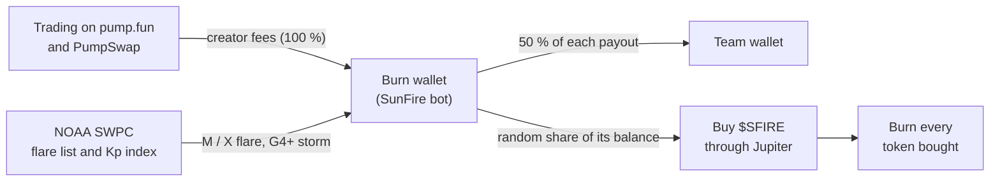

# SunFire ($SFIRE)

**A Solana token whose supply answers to the Sun.**

Every M-class or X-class solar flare and every G4+ geomagnetic storm recorded by NOAA triggers a buyback and burn of $SFIRE. Nobody picks the date or the size. The Sun sets the schedule, an open-source bot carries it out, and every step can be checked on Solana.

| | |
|---|---|
| Website | [sunfire.tech](https://www.sunfire.tech) |
| Burn wallet | [`H51pN1gJHBQkgeRFpXst92w96mDu1EeQzedvgJS4be7`](https://solscan.io/account/H51pN1gJHBQkgeRFpXst92w96mDu1EeQzedvgJS4be7) |
| Token address | Published at launch |
| Data source | [NOAA Space Weather Prediction Center](https://www.swpc.noaa.gov) |

---

## Contents

- [How it works](#how-it-works)
- [Burn schedule](#burn-schedule)
- [On-chain record](#on-chain-record)
- [Safeguards](#safeguards)
- [Architecture](#architecture)
- [Repository](#repository)
- [Running the bot](#running-the-bot)
- [Credits](#credits)
- [About $SFIRE](#about-sfire)

## How it works



1. **Fees.** Pump.fun's creator fee sharing sends 100 % of the creator fees to the burn wallet. The bot collects them on-chain (`sweep_creator_fee` and `distribute_creator_fees`, plus `transfer_creator_fees_to_pump` after graduation). It forwards 50 % of each payout to the team wallet in a public transaction whose memo names the payout, and the other 50 % stays in the burn wallet to fund burns.
2. **Trigger.** Every minute the bot reads NOAA's official GOES flare list and the planetary Kp index. Each M or X flare and each G4+ storm becomes an event, identified by its NOAA start time.
3. **Burn.** For each new event, the bot spends a random share of the burn wallet within the event's range. It buys $SFIRE through Jupiter and burns every token it bought with `BurnChecked`, which permanently lowers the supply.

## Burn schedule

| Event | NOAA threshold | Share of the burn wallet spent |
|---|---|---|
| M-class flare | X-ray flux ≥ 10⁻⁵ W/m² | 5–10 % |
| X-class flare | X-ray flux ≥ 10⁻⁴ W/m² | 10–25 % |
| G4–G5 geomagnetic storm | Planetary Kp ≥ 8 | 30–50 % |

- The exact share is drawn from a recent Solana block hash combined with the event's identity.
- Each event triggers one buyback, never more.
- 0.02 SOL always stays in the wallet to pay transaction fees.
- Events older than six hours are ignored.

Solar Cycle 25 peaked around 2024–2025. X-class flares will become rarer over the coming years, while M-class flares remain common.

## On-chain record

Every action the bot takes is a Solana transaction signed by the burn wallet and tagged with a memo. Together they form a complete and permanent public record of the system.

| Action | Memo | What it records |
|---|---|---|
| Buyback | `SunFire buyback key=M-20261019T1300 event="M2.0 begin 2026-10-19T13:00:00Z" share=7.42% sol=0.0727` | The NOAA event behind the buyback, the share of the burn wallet drawn and the SOL spent |
| Burn | `SunFire burn key=M-20261019T1300 amount=…` | The exact amount of $SFIRE destroyed, tied to its event |
| Fee share | `SunFire fee share for=<payout transaction> sol=0.0500` | The creator fee payout being split and the team's 50 % |

Each event key is the NOAA start time of its flare or storm, so every buyback maps one-to-one to an entry in NOAA's public [flare list](https://services.swpc.noaa.gov/json/goes/primary/xray-flares-7-day.json) or [planetary Kp index](https://services.swpc.noaa.gov/products/noaa-planetary-k-index.json). The full history is on the [burn wallet's Solscan page](https://solscan.io/account/H51pN1gJHBQkgeRFpXst92w96mDu1EeQzedvgJS4be7).

## Safeguards

The bot signs swap instructions built by Jupiter's API, so it never signs them blindly. Before every buyback:

- **Program allowlist.** Only the Compute Budget, System, SPL Token, Associated Token Account and Jupiter v6 programs may appear.
- **No outflows.** SOL can only move into the bot's own wSOL account, and that account can only be closed back to the bot.
- **Simulation.** A simulation must show at most the buyback amount, plus 0.01 SOL for fees and rent, leaving the wallet. It must also show at least Jupiter's quoted minimum arriving in the bot's own $SFIRE account.
- **Price impact.** A buyback with a price impact above 5 % waits for deeper liquidity.

Its bookkeeping:

- **One buyback per event.** The bot reads its own memos back, so it never buys the same event twice, even after a restart.
- **Spoof-proof memos.** A memo only counts when the bot paid for the transaction, so nobody can block a burn or a fee share with a fake memo.
- **Fee share first.** The team's share of each payout goes out before any buyback can spend it. If the bot ever cannot pay a share, buybacks pause and an alert is raised.
- **No silent misses.** A buyback postponed because of price impact raises an alert, and so does any event that ages out of the window without a burn.

Its operation:

- **Dry run by default.** The bot only simulates transactions unless `DRY_RUN=false` is set explicitly.
- **Dedicated wallet.** The burn wallet holds nothing but the SOL used for burns.

## Architecture

SunFire runs in **bot-only mode**: the SunFire bot operates the burn wallet directly, with no intermediary contract. Its source code is in this repository, it is covered by an automated test suite, and every transaction it sends is public on Solana.

The repository also contains a complete Anchor program, [`sunfire-program/`](sunfire-program/), which performs the fee split, the trigger checks and the burns on-chain. It has been tested on devnet and on a local mainnet fork.

## Repository

| Path | Description |
|---|---|
| [`sunfire-keeper/`](sunfire-keeper/) | The bot (Node.js 20). It handles fee collection and the fee share, reads NOAA data, and runs buybacks through Jupiter and burns. It supports bot-only mode and program mode. |
| [`sunfire-site/`](sunfire-site/) | [sunfire.tech](https://www.sunfire.tech): live NASA SDO imagery and NOAA space-weather data. |
| [`sunfire-program/`](sunfire-program/) | The optional Anchor program (Token-2022 and pump.fun compatible). Not deployed. |

## Running the bot

```bash
cd sunfire-keeper
npm install
SFIRE_MINT=<token address> npm start   # dry run: simulates every transaction, sends nothing
node --test test/*.test.js
```

The full configuration (fee share, reserve, limits, alerts, deployment) is in [`sunfire-keeper/README.md`](sunfire-keeper/README.md).

## Credits

- Space-weather data: NOAA Space Weather Prediction Center.
- Solar imagery: NASA/SDO and the AIA, EVE and HMI science teams.

SunFire is not affiliated with or endorsed by NASA or NOAA.

## About $SFIRE

$SFIRE's supply follows the Sun. Tokens are burned only when NOAA records an M-class or X-class flare or a G4+ geomagnetic storm, so solar activity sets the timing and size of every burn.
